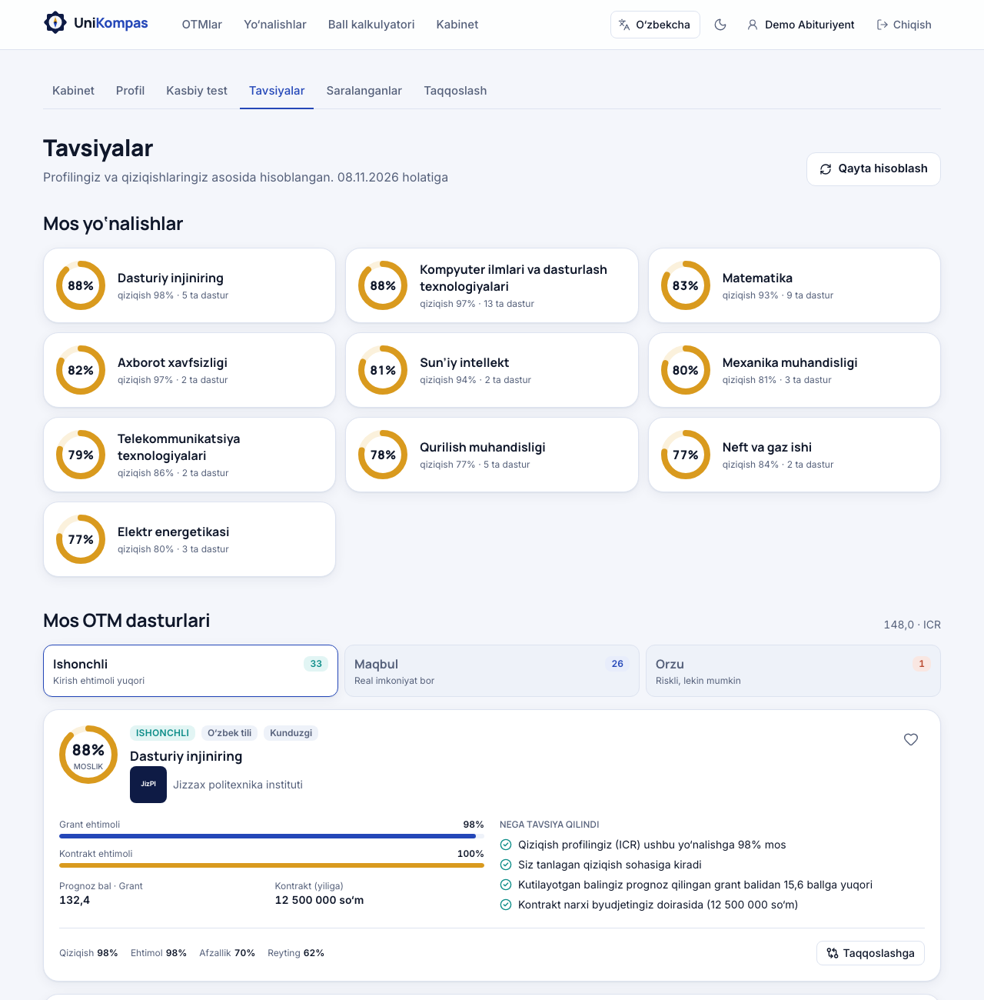
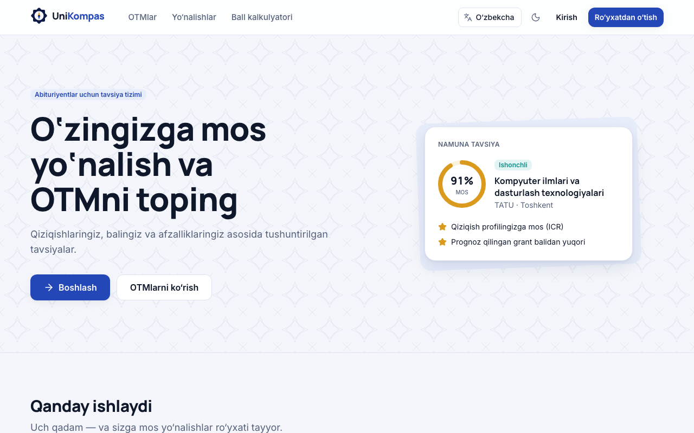
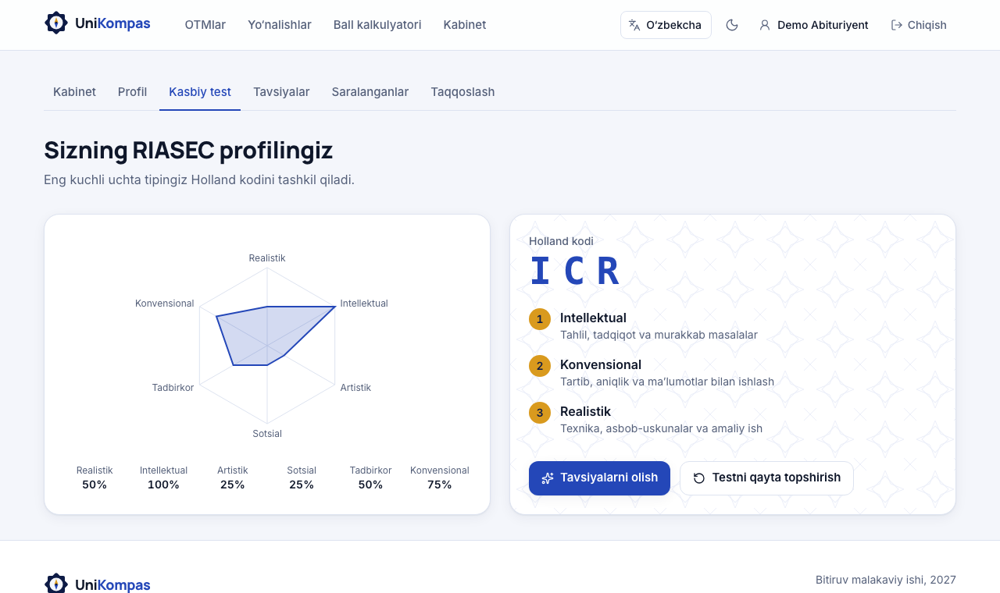
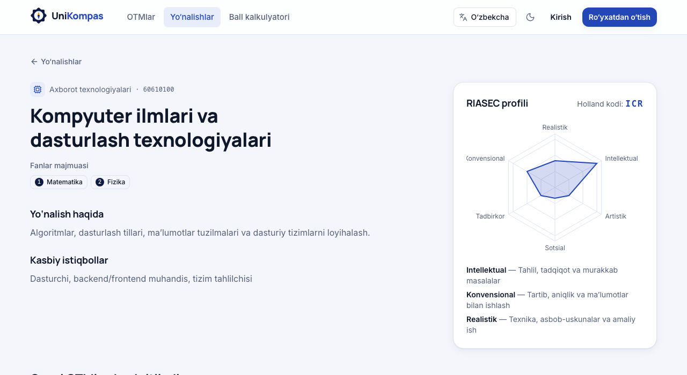
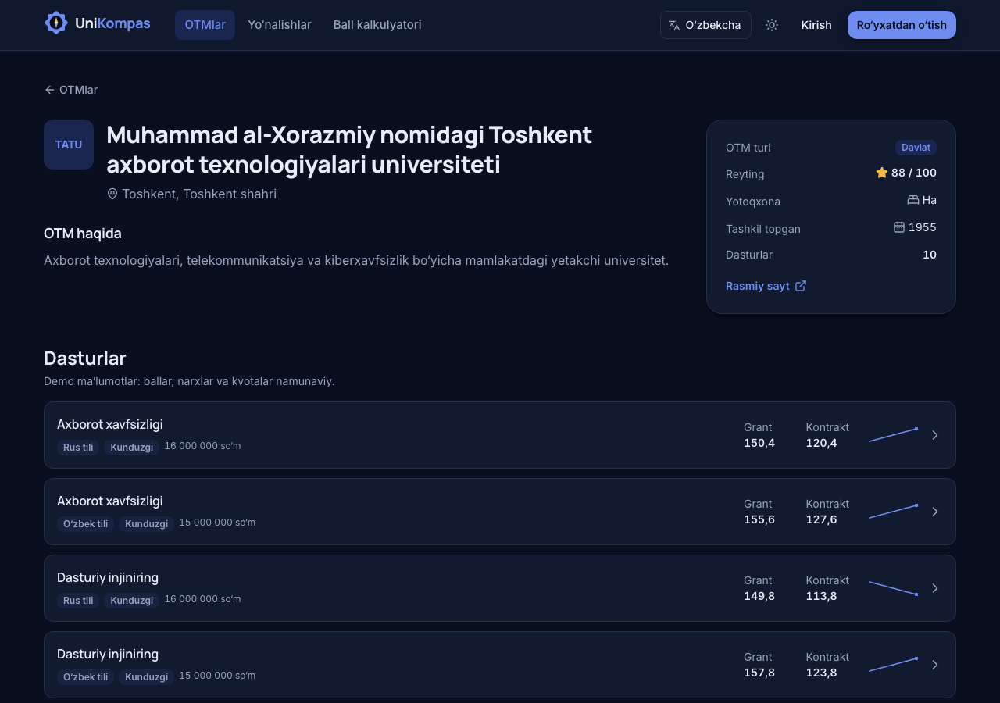
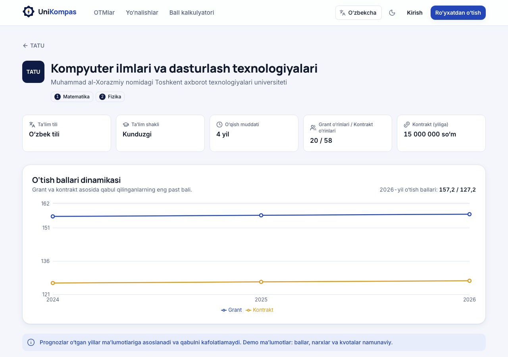
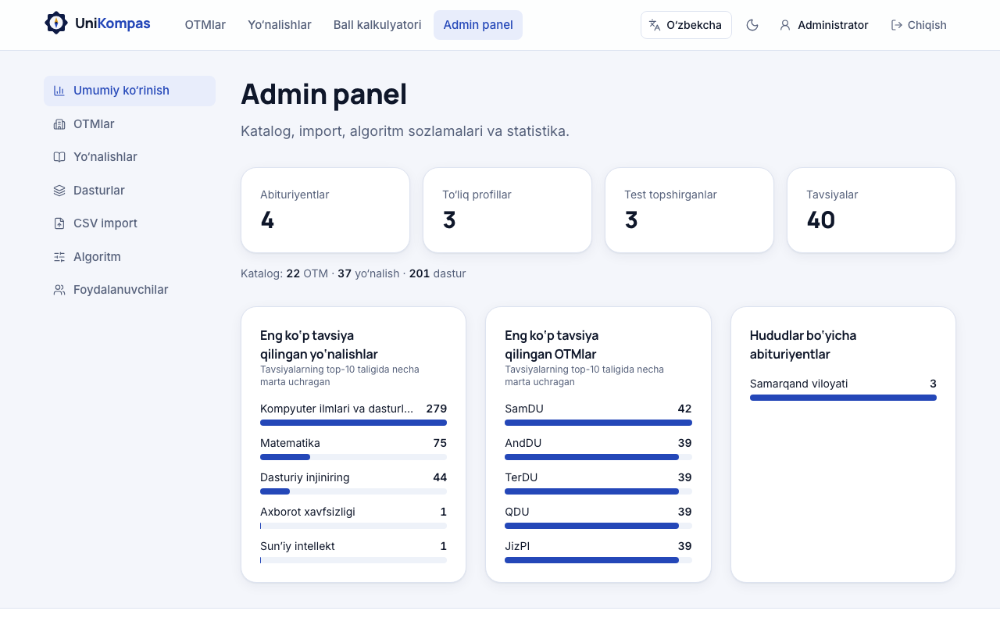
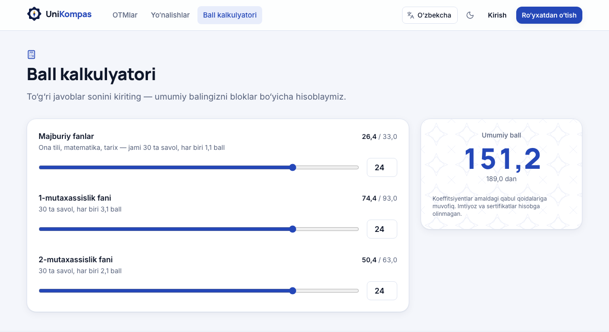
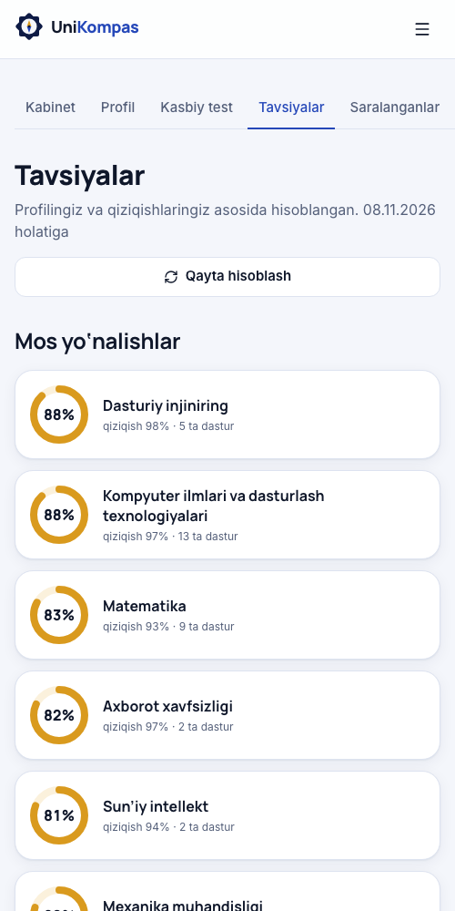
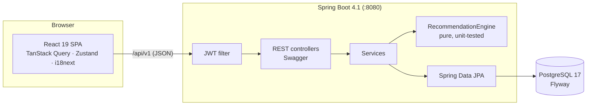

<div align="center">


# UniKompas

**Abituriyentlar uchun mos ta’lim yo‘nalishlari va OTMlarni tavsiya etish tizimi**

*An explainable recommendation platform that helps Uzbek university applicants find study programmes and universities that fit their interests, exam score and preferences.*


[O‘zbekcha](#loyiha-haqida) · [English summary](#english-summary)



</div>

---

## Loyiha haqida

Har yili bir milliondan ortiq abituriyent 200 dan ortiq OTM orasidan tanlov qiladi. O‘tish ballari, kvotalar va kontrakt narxlari turli manbalarda tarqoq holda turadi. Ko‘pchilik esa yo‘nalishni o‘z qiziqishlariga emas, boshqalarning maslahatiga qarab tanlaydi.

**UniKompas** abituriyentning:

- **fanlar majmuasi va kutilayotgan bali**ni,
- **kasbiy qiziqishlari**ni (Holland RIASEC testi, 36 savol),
- **afzalliklari**ni (hudud, til, ta’lim shakli, grant yoki kontrakt, byudjet)

hisobga olib, mos yo‘nalishlar va OTM dasturlarini **Ishonchli / Maqbul / Orzu** toifalarida tavsiya qiladi. Har bir tavsiya **nima uchun** berilgani ham tushuntiriladi.

> Bitiruv malakaviy ishi (BMI). To‘liq texnik topshiriq: [`docs/TZ.md`](docs/TZ.md) · Sinov natijalari: [`docs/TESTING.md`](docs/TESTING.md)

## Imkoniyatlar

| Abituriyent | Administrator |
|---|---|
| OTM va yo‘nalishlar katalogi (filtrlar URL’da) | Statistika paneli |
| Ball kalkulyatori (189 ballik shkala) | OTM, yo‘nalish va dastur CRUD |
| Profil: fanlar, bal, hudud, til, byudjet, sohalar | O‘tish ballari muharriri |
| RIASEC kasbiy testi va radar natijasi | CSV import (qatorlar bo‘yicha xatolar hisoboti bilan) |
| Tushuntiriladigan tavsiyalar + grant/kontrakt ehtimoli | Algoritm vaznlarini sozlash |
| Taqqoslash (2–4 dastur), saralanganlar | Foydalanuvchilar ro‘yxati |

**Interfeys 3 tilda (o‘zbek, rus, ingliz), yorug‘ va qorong‘i temada ishlaydi va mobil qurilmalarga moslashadi.**

## Tavsiya algoritmi

Gibrid, kontentga asoslangan va **tushuntiriladigan** model (batafsil: [TZ §6](docs/TZ.md#6-tavsiya-etish-algoritmi-ilmiy-qism)):

```
1. Qat’iy filtrlar   fanlar majmuasi · til · shakl · hudud · moliyalashtirish va byudjet
2. Mezonlar [0..1]   I  qiziqish   — markazlashtirilgan kosinus (Pearson), RIASEC vektorlari
                     C  ehtimol    — o‘tish balining kalendar yillar bo‘yicha trend prognozi
                                     + logistik egri chiziq: p = 1 / (1 + e^(−(S − P̂)/4))
                                     C = max(p_grant, 0.70 · p_kontrakt)
                     P  afzallik   — hudud va soha mosligi
                     R  reyting    — OTM reytingi / 100
3. Yakuniy ball      0.35·I + 0.35·C + 0.15·P + 0.15·R   (vaznlar admin panelda sozlanadi)
4. Toifalar          Ishonchli C ≥ 0.75 · Maqbul ≥ 0.40 · Orzu ≥ 0.15
5. Sabablar          kod + parametrlar → interfeysda tanlangan tilda matn
```

Ishlab chiqish jarayonida demo ma’lumotlarda o‘tkazilgan tajribalar asosida modelga ikkita aniqlik kiritildi. Ikkalasi ham TZ’da asoslab berilgan:
- **markazlashtirilgan kosinus**: oddiy kosinus musbat RIASEC vektorlarini yaxshi ajratmaydi;
- **kontrakt koeffitsiyenti 0,85 → 0,70**: 0,85 da 60 ta dasturdan 59 tasi “Ishonchli” toifasiga tushib qolgan edi.

## Skrinshotlar

| | |
|---|---|
|  |  |
|  |  |
|  |  |
|  |  |

## Arxitektura



| Qatlam | Texnologiyalar |
|---|---|
| Frontend | React 19, TypeScript 7 (strict), Vite 8, Tailwind CSS 4, React Router 8, TanStack Query 5, Zustand, React Hook Form + Zod, react-i18next, Recharts, Vitest, axe-core |
| Backend | Java 21, Spring Boot 4.1, Spring Security (OAuth2 Resource Server, JWT), Spring Data JPA (Hibernate 7), Flyway, springdoc-openapi, JUnit 5, JaCoCo |
| Ma’lumotlar bazasi | PostgreSQL 17 (JSONB, case-insensitive unique indekslar) |

Loyiha tuzilmasi, kod qoidalari va **“Registon”** dizayn tizimi (Registon koshinlaridan olingan lojuvard, feruza, zarhal va terrakota ranglari): [`CLAUDE.md`](CLAUDE.md).

## Ishga tushirish

Talablar: **JDK 21+**, **Node.js 20+**, **PostgreSQL 17**.

```bash
# 1. Ma’lumotlar bazasi
createuser -P unikompas          # parol: unikompas
createdb -O unikompas unikompas

# 2. Backend → http://localhost:8080 · Swagger: /swagger-ui.html
cd backend && ./mvnw spring-boot:run -Dspring-boot.run.profiles=local

# 3. Frontend → http://localhost:5173
cd frontend && npm install && npm run dev
```

`local` profili demo katalogni (22 OTM, 37 yo‘nalish, 201 dastur, 2024–2026 yillar ballari) va quyidagi hisoblarni avtomatik yaratadi:

| Rol | E-pochta | Parol |
|---|---|---|
| Abituriyent | `abituriyent@unikompas.uz` | `Demo123!` |
| Administrator | `admin@unikompas.uz` | `Admin123!` |

> ⚠️ Demo katalogda OTM nomlari haqiqiy, lekin reyting, ballar, narx va kvotalar **namunaviy**. Haqiqiy ma’lumotlar admin paneldagi CSV import orqali yuklanadi.

## Sifat

| Ko‘rsatkich | Natija |
|---|---|
| Backend testlari | **73** (unit + MockMvc integratsion, haqiqiy PostgreSQL bilan) |
| Frontend testlari | **33** (Vitest + Testing Library, axe-core a11y) |
| Test qamrovi (JaCoCo) | butun backend **90%** satr; tavsiya dvigateli **99%** satr (80% chegara build’da tekshiriladi) |
| API kechikishi (lokal, p95) | katalog ≤ 8 ms · tavsiya generatsiyasi 34 ms |
| Masshtablanish | 5 000 ta dastur **4 ms** da baholanadi (talab: < 1 s) |
| Accessibility | asosiy ekranlarda WCAG 2.1 A/AA bo‘yicha qoidabuzarlik yo‘q (axe-core) |
| Boshlang‘ich JS hajmi | 89 KB gzip (marshrutlar bo‘yicha code splitting) |

```bash
cd backend  && ./mvnw verify                 # testlar + qamrov hisoboti (target/site/jacoco)
cd backend  && ./mvnw test -Pperf            # vaqtga bog‘liq unumdorlik testi (5 000 dastur)
cd frontend && npm run typecheck && npm run lint && npm test && npm run build
```

Har bir bosqich alohida branchda bajarilgan va kod review’dan o‘tgan. Commitlar [Conventional Commits](https://www.conventionalcommits.org) formatida yozilgan. Ishlash jarayoni CLAUDE.md §9 da tasvirlangan.

## English summary

UniKompas is a full-stack thesis project: a **hybrid, explainable recommender** for university applicants in Uzbekistan. Applicants enter their exam subject pair, expected score (0–189) and preferences, and take a 36-item Holland RIASEC questionnaire. The engine then:
- filters programmes;
- scores each one on interest (centred cosine), admission chance (calendar-year trend forecast + logistic model), preferences and university rating;
- groups the results into Safe / Target / Reach bands with machine-readable reasons, which the UI renders in Uzbek, Russian or English.

Stack: Spring Boot 4.1 + PostgreSQL, React 19 + TypeScript. Engineering highlights:
- 106 automated tests and a JaCoCo coverage gate;
- uniform error codes translated on the client;
- race-free idempotent writes and N+1-free catalog queries;
- route-level code splitting;
- a design system derived from the topic itself.

## Muallif

**Malikov Og‘abek Sherzod o‘g‘li** — bitiruv malakaviy ishi, [Universitet nomi], 2027 · [GitHub](https://github.com/malikovogabek)
