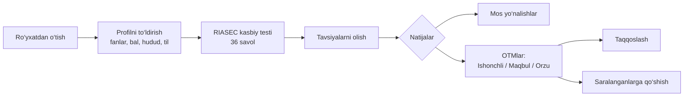
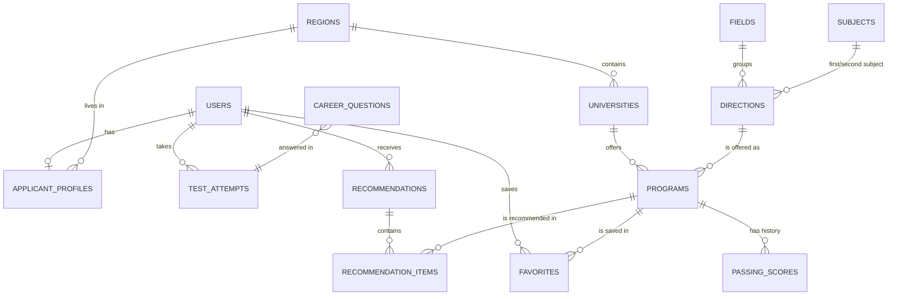
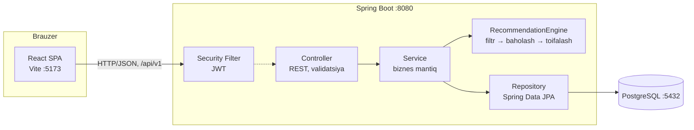

# TEXNIK TOPSHIRIQ (TZ)

**“Abituriyentlar uchun mos ta’lim yo‘nalishlari va oliy ta’lim muassasalarini tavsiya etish tizimini yaratish”**

| Parametr | Qiymat |
|---|---|
| Tizimning to‘liq nomi | Abituriyentlarga ta’lim yo‘nalishi va OTMni tavsiya etuvchi axborot tizimi |
| Qisqa nomi (brend) | **UniKompas** |
| Hujjat turi | Texnik topshiriq (GOST 34.602-89 tuzilmasi asosida, soddalashtirilgan) |
| Versiya | 1.0 |
| Sana | 2026-yil 8-noyabr |
| Bajaruvchi (talaba) | Malikov Og‘abek Sherzod o‘g‘li, [guruh], [fakultet] |
| Ilmiy rahbar | [F.I.Sh., ilmiy darajasi] |
| Ish turi | Bitiruv malakaviy ishi (BMI) |

---

## Mundarija

1. [Umumiy ma’lumotlar](#1-umumiy-malumotlar)
2. [Mavzuning dolzarbligi va muammoning qo‘yilishi](#2-mavzuning-dolzarbligi-va-muammoning-qoyilishi)
3. [Tizim yaratishdan maqsad va vazifalar](#3-tizim-yaratishdan-maqsad-va-vazifalar)
4. [Avtomatlashtirish obyekti va foydalanuvchilar](#4-avtomatlashtirish-obyekti-va-foydalanuvchilar)
5. [Funksional talablar](#5-funksional-talablar)
6. [Tavsiya etish algoritmi (ilmiy qism)](#6-tavsiya-etish-algoritmi-ilmiy-qism)
7. [Ma’lumotlar modeli](#7-malumotlar-modeli)
8. [API spetsifikatsiyasi](#8-api-spetsifikatsiyasi)
9. [Nofunksional talablar](#9-nofunksional-talablar)
10. [Texnologiyalar steki va arxitektura](#10-texnologiyalar-steki-va-arxitektura)
11. [Foydalanuvchi interfeysi va dizayn](#11-foydalanuvchi-interfeysi-va-dizayn)
12. [Ishlarni bajarish bosqichlari](#12-ishlarni-bajarish-bosqichlari)
13. [Sinovdan o‘tkazish va qabul qilish tartibi](#13-sinovdan-otkazish-va-qabul-qilish-tartibi)
14. [Cheklovlar, xavflar va kelajakdagi rivojlanish](#14-cheklovlar-xavflar-va-kelajakdagi-rivojlanish)
15. [BMI (diplom ishi) tuzilmasi bilan bog‘liqlik](#15-bmi-diplom-ishi-tuzilmasi-bilan-bogliqlik)
16. [Atamalar lug‘ati](#16-atamalar-lugati)

---

## 1. Umumiy ma’lumotlar

### 1.1. Tizim haqida qisqacha

**UniKompas** — abituriyentning fanlar majmuasi, kutilayotgan test bali, kasbiy qiziqishlari (RIASEC testi) va shaxsiy afzalliklari (hudud, ta’lim tili, ta’lim shakli, moliyalashtirish turi) asosida unga **eng mos ta’lim yo‘nalishlari** hamda **oliy ta’lim muassasalari (OTM)**ni tushuntirish bilan tavsiya qiluvchi veb-ilova.

### 1.2. Ishlab chiqish uchun asos

- Kafedra tomonidan tasdiqlangan BMI mavzusi.
- O‘zbekiston Respublikasida oliy ta’limga qabul jarayonining raqamlashtirilishi (my.uzbmb.uz, my.gov.uz) va abituriyentlarga kasb tanlashda yordam beruvchi vositalarga bo‘lgan ehtiyoj.

### 1.3. Ishlarni bajarish muddatlari

| Bosqich | Muddat (taxminiy) |
|---|---|
| TZ va loyihalash | 2026-yil noyabr |
| Dasturiy ta’minotni ishlab chiqish | 2026-yil noyabr — 2027-yil fevral |
| Sinov, ma’lumotlarni to‘ldirish, hujjatlash | 2027-yil mart — aprel |
| Himoyaga tayyorgarlik | 2027-yil may |

> Aniq sanalar kafedra jadvaliga qarab yangilanadi.

---

## 2. Mavzuning dolzarbligi va muammoning qo‘yilishi

### 2.1. Dolzarbligi

O‘zbekistonda har yili bir milliondan ortiq abituriyent OTMlarga hujjat topshiradi, davlat, nodavlat va xorijiy OTM filiallari soni esa 200 tadan oshgan. Tanlov imkoniyati keng, lekin abituriyent qaror qabul qilishi uchun zarur ma’lumotlar turli manbalarda tarqoq holda turibdi.

> **Eslatma (diplom ishi uchun):** abituriyentlar va OTMlar sonini BMI matniga yozishdan oldin rasmiy manbalardan (uzbmb.uz, edu.uz, stat.uz) aniq yil bilan tekshirib, havolasini keltiring.

### 2.2. Mavjud muammolar

1. **Ma’lumotlar tarqoqligi.** O‘tish ballari, kvotalar, kontrakt narxlari va fanlar majmuasi turli saytlarda, ko‘pincha PDF yoki jadval ko‘rinishida e’lon qilinadi.
2. **Qaror nobyektivligi.** Ko‘p abituriyentlar yo‘nalishni ota-ona maslahati, nufuz yoki do‘stlar ta’sirida tanlaydi, o‘z qiziqish va qobiliyatlarini hisobga olmaydi. Natijada o‘qishga motivatsiya pasayadi va mutaxassislik bo‘yicha ishlamaslik holatlari ko‘payadi.
3. **Imkoniyatni baholay olmaslik.** Abituriyent o‘z bali bilan qaysi OTMga grant yoki kontrakt asosida kirish ehtimoli qanchaligini bilmaydi. Shu sabab variantlar “juda xavfli” yoki “juda past” tanlanadi.
4. **Fanlar majmuasi bilan nomuvofiqlik.** Abituriyent topshirayotgan fanlariga mos kelmaydigan yo‘nalishlarni ko‘rib, vaqt yo‘qotadi.

### 2.3. Mavjud yechimlar tahlili

| Yechim | Afzalligi | Kamchiligi |
|---|---|---|
| my.uzbmb.uz (rasmiy portal) | Rasmiy, aniq ma’lumot | Tavsiya bermaydi, qiziqishni hisobga olmaydi |
| OTM saytlari | Batafsil ma’lumot | Faqat bitta OTM haqida, taqqoslab bo‘lmaydi |
| Telegram-kanallar, “ball kalkulyator” botlari | Tez va qulay | Tizimsiz, ishonchliligi past, shaxsiylashtirilmagan |
| Xorijiy platformalar (Niche, College Board BigFuture, Studyportals) | Kuchli tavsiya tizimlari | O‘zbekiston OTMlari va DTM tizimini qamramaydi |

**Xulosa:** milliy qabul tizimiga (fanlar majmuasi, 189 ballik shkala, grant/kontrakt) moslashtirilgan va **tushuntiriladigan** tavsiya beradigan yagona platforma yo‘q. UniKompas aynan shu bo‘shliqni to‘ldiradi.

### 2.4. Ilmiy yangilik va amaliy ahamiyat

- **Ilmiy yangilik:** Holland (RIASEC) kasbiy qiziqishlar nazariyasi, o‘tish ballarining trendga asoslangan prognozi va afzalliklarga asoslangan filtrlashni birlashtirgan **gibrid, tushuntiriladigan** (explainable) tavsiya modeli milliy qabul tizimi sharoitiga moslashtiriladi.
- **Amaliy ahamiyat:** abituriyentlar, ota-onalar, maktab va litsey kasbga yo‘naltirish mutaxassislari hamda repetitorlik markazlari foydalanishi mumkin.

---

## 3. Tizim yaratishdan maqsad va vazifalar

### 3.1. Maqsad

Abituriyentning shaxsiy ma’lumotlari va qiziqishlari asosida unga mos ta’lim yo‘nalishlari va OTMlarni asoslangan, tushuntirilgan va kirish ehtimoli bo‘yicha toifalangan holda tavsiya qiluvchi veb-ilovani yaratish.

### 3.2. Vazifalar

1. Sohani tahlil qilish: qabul tizimi, fanlar majmuasi, ballarni hisoblash tartibi, mavjud yechimlar.
2. Kasbiy qiziqishlarni aniqlash uchun RIASEC asosidagi test modulini loyihalash.
3. O‘tish ballari tarixiga asoslangan kirish ehtimolini baholash modelini ishlab chiqish.
4. Ko‘p mezonli (gibrid) tavsiya algoritmini ishlab chiqish va tushuntirish (explanation) mexanizmini yaratish.
5. Ma’lumotlar bazasi va REST API’ni loyihalash hamda Java Spring Boot asosida amalga oshirish.
6. React + TypeScript asosida qulay va moslashuvchan (responsive) foydalanuvchi interfeysini yaratish.
7. Ma’lumotlarni boshqarish uchun administrator panelini yaratish (CRUD, CSV import, statistika).
8. Tizimni sinovdan o‘tkazish va tavsiyalar sifatini baholash.

---

## 4. Avtomatlashtirish obyekti va foydalanuvchilar

### 4.1. Avtomatlashtirish obyekti

Abituriyentning ta’lim yo‘nalishi va OTM tanlash jarayoni: ma’lumot qidirish, variantlarni solishtirish, imkoniyatlarni baholash va yakuniy ro‘yxatni shakllantirish.

### 4.2. Foydalanuvchi rollari

| Rol | Tavsif | Asosiy imkoniyatlar |
|---|---|---|
| **Mehmon** (ro‘yxatdan o‘tmagan) | Saytga kirgan har qanday foydalanuvchi | Bosh sahifa, OTM va yo‘nalishlar katalogi, ball kalkulyatori |
| **Abituriyent** (`APPLICANT`) | Ro‘yxatdan o‘tgan foydalanuvchi | Profil, kasbiy test, tavsiyalar, taqqoslash, saralanganlar |
| **Administrator** (`ADMIN`) | Tizim ma’lumotlarini boshqaruvchi xodim | OTM, yo‘nalish, dastur va o‘tish ballarini boshqarish, CSV import, algoritm vaznlari, statistika |

### 4.3. Asosiy foydalanish ssenariysi (User Journey)



---

## 5. Funksional talablar

Ustuvorlik **MoSCoW** usulida belgilangan: **M** — albatta bo‘lishi kerak (Must), **S** — bo‘lishi kerak (Should), **C** — bo‘lishi mumkin (Could).

### M1. Autentifikatsiya va avtorizatsiya

| ID | Talab | Ustuvorlik |
|---|---|---|
| FR-1.1 | Foydalanuvchi F.I.Sh., e-pochta va parol bilan ro‘yxatdan o‘tadi | M |
| FR-1.2 | Foydalanuvchi e-pochta va parol bilan tizimga kiradi va JWT token oladi | M |
| FR-1.3 | Tizim rolga qarab sahifa va API’larga kirishni cheklaydi (`APPLICANT`, `ADMIN`) | M |
| FR-1.4 | Foydalanuvchi tizimdan chiqadi (token mijoz tomonda o‘chiriladi) | M |
| FR-1.5 | Parolni o‘zgartirish | C |

### M2. Abituriyent profili

| ID | Talab | Ustuvorlik |
|---|---|---|
| FR-2.1 | Abituriyent hududini (viloyat) tanlaydi | M |
| FR-2.2 | Abituriyent fanlar majmuasini tanlaydi (1-fan va 2-fan) | M |
| FR-2.3 | Abituriyent kutilayotgan umumiy balini (0–189) kiritadi yoki **ball kalkulyatori** orqali hisoblaydi | M |
| FR-2.4 | Ta’lim tili (o‘zbek, rus, ingliz) va ta’lim shakli (kunduzgi, sirtqi, kechki, masofaviy) afzalliklarini tanlaydi | M |
| FR-2.5 | Moliyalashtirish turini tanlaydi: faqat grant yoki kontrakt ham mumkin, kontrakt uchun maksimal summa | M |
| FR-2.6 | Boshqa hududga ko‘chib o‘qishga tayyorligini belgilaydi | M |
| FR-2.7 | Qiziqish sohalarini tanlaydi (IT, tibbiyot, iqtisodiyot va h.k.) | S |

### M3. Ball kalkulyatori

| ID | Talab | Ustuvorlik |
|---|---|---|
| FR-3.1 | To‘g‘ri javoblar soni bo‘yicha balni hisoblaydi: majburiy fanlar (3×10 savol × 1,1), 1-fan (30 × 3,1), 2-fan (30 × 2,1). Maksimal bal 189 | M |
| FR-3.2 | Kalkulyator mehmonlar uchun ham ochiq | S |

> Koeffitsiyentlar amaldagi qabul qoidalariga muvofiq **sozlanadigan konstanta** sifatida saqlanadi. Qoidalar o‘zgarsa, kodni o‘zgartirmasdan yangilash mumkin.

### M4. Kasbiy qiziqishlar testi (RIASEC)

| ID | Talab | Ustuvorlik |
|---|---|---|
| FR-4.1 | Tizim 36 ta savol beradi (6 tip × 6 savol), har biriga 1–5 shkalada (Likert) javob beriladi | M |
| FR-4.2 | Natija 6 o‘lchamli vektor (R, I, A, S, E, C) va Holland kodi (masalan, `IRC`) sifatida hisoblanadi | M |
| FR-4.3 | Natija radar (o‘rgimchak to‘ri) diagrammasida va har bir tip tavsifi bilan ko‘rsatiladi | M |
| FR-4.4 | Testni qayta topshirish mumkin, oxirgi natija tavsiyada ishlatiladi, tarix saqlanadi | S |

### M5. Katalog (OTM va yo‘nalishlar)

| ID | Talab | Ustuvorlik |
|---|---|---|
| FR-5.1 | OTMlar ro‘yxati: nom bo‘yicha qidiruv, hudud va tur (davlat, nodavlat, xorijiy filial) bo‘yicha filtr, sahifalash | M |
| FR-5.2 | OTM sahifasi: tavsif, manzil, sayt, reyting, yotoqxona mavjudligi, yo‘nalishlar ro‘yxati | M |
| FR-5.3 | Yo‘nalishlar ro‘yxati: soha, fanlar majmuasi bo‘yicha filtr, qidiruv | M |
| FR-5.4 | Yo‘nalish sahifasi: tavsif, kasbiy istiqbollar, RIASEC profili, shu yo‘nalish bor OTMlar | M |
| FR-5.5 | Dastur (OTM + yo‘nalish + til + shakl) sahifasi: kvotalar, kontrakt narxi, so‘nggi yillar o‘tish ballari grafigi | M |

### M6. Tavsiya tizimi

| ID | Talab | Ustuvorlik |
|---|---|---|
| FR-6.1 | Profil asosida tavsiyalarni generatsiya qiladi ([6-bo‘lim](#6-tavsiya-etish-algoritmi-ilmiy-qism)) | M |
| FR-6.2 | **Top-10 mos yo‘nalish**ni moslik foizi bilan ko‘rsatadi | M |
| FR-6.3 | Mos dasturlarni (OTMlarni) 3 toifada ko‘rsatadi: **Ishonchli**, **Maqbul**, **Orzu** | M |
| FR-6.4 | Har bir tavsiya uchun **sabablar** ko‘rsatiladi (masalan, “Kutilayotgan balingiz prognoz qilingan grant balidan 8,4 ballga yuqori”) | M |
| FR-6.5 | Tavsiya natijalari saqlanadi va tarixni ko‘rish mumkin | S |
| FR-6.6 | Natijalar tartiblanadi va filtrlanadi (til, shakl, hudud) | S |
| FR-6.7 | Tavsiyani PDF sifatida yuklab olish | C |

### M7. Taqqoslash va saralanganlar

| ID | Talab | Ustuvorlik |
|---|---|---|
| FR-7.1 | Abituriyent dasturni “Saralanganlar”ga qo‘shadi yoki undan o‘chiradi | M |
| FR-7.2 | 2–4 ta dasturni yonma-yon taqqoslaydi: ballar, narx, kvota, hudud, reyting | S |

### M8. Administrator paneli

| ID | Talab | Ustuvorlik |
|---|---|---|
| FR-8.1 | OTMlarni yaratish, tahrirlash va o‘chirish (CRUD) | M |
| FR-8.2 | Yo‘nalishlar CRUD (kod, nom, soha, fanlar majmuasi, RIASEC profili) | M |
| FR-8.3 | Dasturlar CRUD (OTM + yo‘nalish + til + shakl + kvota + narx) | M |
| FR-8.4 | O‘tish ballarini qo‘lda kiritish | M |
| FR-8.5 | O‘tish ballarini **CSV fayl** orqali ommaviy import qilish, xato qatorlar haqida hisobot | S |
| FR-8.6 | Tavsiya algoritmi vaznlarini sozlash (w₁…w₄) | S |
| FR-8.7 | Statistika paneli: foydalanuvchilar soni, testlar soni, eng ko‘p tavsiya qilingan yo‘nalish va OTMlar | S |
| FR-8.8 | Foydalanuvchilar ro‘yxatini ko‘rish | C |

### M9. Lokalizatsiya (ko‘p tillilik)

| ID | Talab | Ustuvorlik |
|---|---|---|
| FR-9.1 | Interfeys 3 tilda ishlaydi: **o‘zbek (lotin, standart)**, **rus**, **ingliz** | M |
| FR-9.2 | Til sarlavhadagi (header) tanlagich orqali sahifani qayta yuklamasdan almashtiriladi, tanlov brauzerda saqlanadi | M |
| FR-9.3 | Birinchi kirishda til brauzer sozlamasidan aniqlanadi, aniqlanmasa o‘zbek tili tanlanadi | S |
| FR-9.4 | Backend xatolarni **kod** bilan qaytaradi (`VALIDATION_ERROR`, `EMAIL_TAKEN`, …), frontend ularni tanlangan tilga tarjima qiladi | M |
| FR-9.5 | Sana, raqam va pul summalari (so‘m) tanlangan til qoidalari bo‘yicha formatlanadi (`Intl`) | S |
| FR-9.6 | RIASEC test savollari va tip tavsiflari 3 tilda beriladi | S |

> Katalog ma’lumotlari (OTM va yo‘nalish nomlari, tavsiflar) birinchi versiyada o‘zbek tilida saqlanadi. Ularni ko‘p tilli qilish 14.3-bo‘limda rejalashtirilgan.

---

## 6. Tavsiya etish algoritmi (ilmiy qism)

Tizim **gibrid, tushuntiriladigan, kontentga asoslangan** (content-based) tavsiya modelidan foydalanadi. U bilimga asoslangan (knowledge-based) filtrlash bilan ko‘p mezonli baholashni birlashtiradi. Model sovuq start muammosiga chidamli: boshqa foydalanuvchilar ma’lumotlari talab qilinmaydi.

### 6.1. Kirish ma’lumotlari

| Belgi | Ma’no |
|---|---|
| `S` | Abituriyentning kutilayotgan bali (0–189) |
| `(f₁, f₂)` | Abituriyent fanlar majmuasi |
| `u = (R, I, A, S, E, C)` | Abituriyentning RIASEC vektori (har bir komponent 0–1 oralig‘ida normallashtirilgan) |
| `region, lang, form, fin, budget, relocate` | Afzalliklar |
| `d = (R, I, A, S, E, C)` | Yo‘nalishning RIASEC profili (admin yoki ekspert kiritadi, 0–10) |
| `P_y` | Dasturning `y`-yildagi o‘tish bali (grant va kontrakt alohida) |

### 6.2. 1-qadam — qat’iy filtrlash (Hard filters)

Dastur nomzodlar ro‘yxatiga faqat quyidagi shartlar bajarilganda kiradi:

1. Dastur yo‘nalishining fanlar majmuasi `(f₁, f₂)` ga **aynan mos** keladi.
2. Ta’lim tili va shakli abituriyent afzalliklariga mos keladi (agar afzallik belgilangan bo‘lsa).
3. `relocate = false` bo‘lsa, faqat abituriyent hududidagi OTMlar qoladi.
4. `fin = GRANT_ONLY` bo‘lsa, grant kvotasi > 0 bo‘lgan dasturlar qoladi. `fin = CONTRACT_OK` bo‘lsa, kontrakt narxi `≤ budget` bo‘lishi kerak (yoki dasturda grant bo‘lishi kerak).

### 6.3. 2-qadam — mezonlar bo‘yicha baholash

Har bir nomzod dastur uchun 4 ta mezon `[0; 1]` oralig‘ida hisoblanadi.

#### a) Qiziqish mosligi — `I`

Abituriyent va yo‘nalish RIASEC vektorlari orasidagi **kosinus o‘xshashlik**:

```
I = (u · d) / (‖u‖ · ‖d‖)
```

Test topshirilmagan bo‘lsa (sovuq start), `I` qiziqish sohalari bo‘yicha hisoblanadi: yo‘nalish sohasi tanlangan sohalar orasida bo‘lsa `I = 1`, aks holda `I = 0.3`.

#### b) Kirish ehtimoli — `C`

1. **O‘tish balini prognozlash.** Oxirgi `n ≤ 3` yil ballari bo‘yicha o‘rtacha yillik o‘zgarish (trend):
   ```
   Δ = clamp( (P_last − P_first) / (n − 1), −10, +10 )
   P̂ = P_last + Δ          (n = 1 bo‘lsa, P̂ = P_last)
   ```
2. **Ehtimolni baholash** (logistik funksiya, `k = 4` — tarqoqlik koeffitsiyenti):
   ```
   p = 1 / (1 + e^(−(S − P̂) / k))
   ```
   `S = P̂` bo‘lsa, `p = 0.5`; balandan 10 ball yuqori bo‘lsa, `p ≈ 0.92`; 10 ball past bo‘lsa, `p ≈ 0.08`.
3. Grant va kontrakt uchun alohida hisoblanadi:
   ```
   GRANT_ONLY  : C = p_grant
   CONTRACT_OK : C = max(p_grant, 0.85 · p_contract)
   ```
   `0.85` koeffitsiyenti grantning abituriyent uchun afzalroq ekanini aks ettiradi.

#### c) Afzalliklar mosligi — `P`

```
P = 0.6 · regionMatch + 0.4 · fieldMatch
regionMatch = 1 (o‘z hududi) | 0.5 (boshqa hudud, ko‘chishga tayyor)
fieldMatch  = 1 (soha tanlangan) | 0 (aks holda)
```

#### d) OTM reytingi — `R`

```
R = rating / 100      (rating — 0..100, admin kiritadi yoki rasmiy reytingdan olinadi)
```

### 6.4. 3-qadam — yakuniy ball

```
Score = w₁·I + w₂·C + w₃·P + w₄·R,     w₁ + w₂ + w₃ + w₄ = 1
```

| Vazn | Standart qiymat | Asoslash |
|---|---|---|
| w₁ (qiziqish) | 0.35 | Uzoq muddatli qoniqish va motivatsiya |
| w₂ (ehtimol) | 0.35 | Real kirish imkoniyati |
| w₃ (afzallik) | 0.15 | Hudud va soha qulayligi |
| w₄ (reyting) | 0.15 | Ta’lim sifati |

Vaznlar admin panelidan o‘zgartiriladi (FR-8.6). Diplom ishining eksperimental qismida turli vazn kombinatsiyalari solishtiriladi.

### 6.5. 4-qadam — toifalash va natijani shakllantirish

| Toifa | Shart | Ma’nosi | UI rangi |
|---|---|---|---|
| **Ishonchli** (Safe) | `C ≥ 0.75` | Kirish ehtimoli yuqori | Feruza |
| **Maqbul** (Target) | `0.40 ≤ C < 0.75` | Real imkoniyat bor | Lojuvard |
| **Orzu** (Reach) | `0.15 ≤ C < 0.40` | Riskli, lekin mumkin | Terrakota |
| — | `C < 0.15` | Ko‘rsatilmaydi | — |

- **Mos yo‘nalishlar (Top-10):** har bir yo‘nalish bo‘yicha eng yuqori `Score`ga ega dastur olinadi va yo‘nalishlar shu ball bo‘yicha tartiblanadi.
- **Mos OTMlar:** har bir toifada `Score` bo‘yicha tartiblangan Top-N (standart 10) dastur.

### 6.6. Tushuntirish (Explainability)

Har bir tavsiya uchun sabablar shablonlar asosida generatsiya qilinadi:

| Shart | Matn namunasi |
|---|---|
| `I ≥ 0.8` | “Qiziqish profilingiz (IRC) ushbu yo‘nalishga 87% mos” |
| `S > P̂_grant` | “Kutilayotgan balingiz prognoz qilingan grant balidan 8,4 ballga yuqori” |
| `S < P̂_grant`, lekin kontrakt mumkin | “Grant uchun 3,2 ball yetmaydi, kontrakt asosida kirish ehtimoli yuqori” |
| `regionMatch = 1` | “OTM sizning hududingizda joylashgan” |
| `Δ > 3` | “Diqqat: o‘tish bali so‘nggi yillarda o‘sish tendensiyasiga ega” |

### 6.7. Murakkablik

`N` — dasturlar soni. Filtrlash va baholash `O(N)`, tartiblash `O(N log N)`. 5 000 dastur uchun hisoblash xotirada 1 soniyadan kam vaqt oladi.

### 6.8. Sifatni baholash usuli

1. **Ekspert baholash:** 20–30 nafar abituriyent yoki talaba tizimdan foydalanadi va Top-5 tavsiyani 1–5 shkalada baholaydi. Ko‘rsatkichlar: o‘rtacha baho, **Precision@5** (ijobiy baholanganlar ulushi).
2. **Retrospektiv tekshiruv:** oldingi yillar ma’lumotlari bilan prognoz qilingan o‘tish bali haqiqiy bal bilan solishtiriladi (MAE — o‘rtacha absolyut xato).
3. **SUS (System Usability Scale)** so‘rovnomasi orqali interfeys qulayligi baholanadi.

---

## 7. Ma’lumotlar modeli

### 7.1. ER-diagramma



### 7.2. Jadvallar

**users** — tizim foydalanuvchilari

| Ustun | Tur | Izoh |
|---|---|---|
| id | BIGSERIAL PK | |
| full_name | VARCHAR(120) | |
| email | VARCHAR(160) UNIQUE | Login |
| password_hash | VARCHAR(100) | BCrypt |
| role | VARCHAR(20) | `APPLICANT`, `ADMIN` |
| created_at | TIMESTAMPTZ | |

**regions** — viloyatlar (12 viloyat, Qoraqalpog‘iston Respublikasi, Toshkent shahri)
`id, name`

**subjects** — test fanlari
`id, code, name` (masalan, `MATH` — Matematika)

**fields** — bilim sohalari
`id, code, name, icon` (masalan, `IT` — Axborot texnologiyalari)

**universities** — OTMlar

| Ustun | Tur | Izoh |
|---|---|---|
| id | BIGSERIAL PK | |
| name, short_name | VARCHAR | |
| region_id | FK → regions | |
| city, address, website | VARCHAR | |
| type | VARCHAR(20) | `STATE`, `PRIVATE`, `FOREIGN_BRANCH` |
| rating | SMALLINT | 0–100 |
| has_dormitory | BOOLEAN | |
| founded_year | SMALLINT | |
| description | TEXT | |
| logo_url | VARCHAR | |

**directions** — ta’lim yo‘nalishlari (bakalavriat)

| Ustun | Tur | Izoh |
|---|---|---|
| id | BIGSERIAL PK | |
| code | VARCHAR(12) UNIQUE | Klassifikator kodi, masalan `60610100` |
| name | VARCHAR(200) | |
| field_id | FK → fields | |
| first_subject_id, second_subject_id | FK → subjects | Fanlar majmuasi |
| riasec_r … riasec_c | SMALLINT ×6 | 0–10, yo‘nalish profili |
| description, career_prospects | TEXT | |

**programs** — aniq OTMdagi dastur (taklif)

| Ustun | Tur | Izoh |
|---|---|---|
| id | BIGSERIAL PK | |
| university_id | FK | |
| direction_id | FK | |
| language | VARCHAR(5) | `UZ`, `RU`, `EN` |
| study_form | VARCHAR(20) | `FULL_TIME`, `PART_TIME`, `EVENING`, `DISTANCE` |
| grant_quota, contract_quota | INT | |
| contract_fee | BIGINT | so‘m/yil |
| duration_years | SMALLINT | |
| UNIQUE | (university_id, direction_id, language, study_form) | |

**passing_scores** — o‘tish ballari tarixi
`id, program_id FK, year SMALLINT, grant_score NUMERIC(5,1) NULL, contract_score NUMERIC(5,1) NULL, UNIQUE(program_id, year)`

**applicant_profiles** — abituriyent profili
`id, user_id FK UNIQUE, region_id, first_subject_id, second_subject_id, expected_score NUMERIC(5,1), preferred_language, preferred_study_form, financing (GRANT_ONLY | CONTRACT_OK), max_contract_fee, willing_to_relocate, updated_at`
**profile_fields** (M:N) — `profile_id, field_id`

**career_questions** — RIASEC savollari
`id, text, riasec_type CHAR(1), order_no`

**test_attempts** — test natijalari
`id, user_id, score_r … score_c NUMERIC(4,3), holland_code VARCHAR(3), created_at`

**recommendations** — tavsiya sessiyasi
`id, user_id, input_snapshot JSONB, weights JSONB, created_at`

**recommendation_items** — tavsiya elementlari
`id, recommendation_id, program_id, rank, total_score, interest_score, chance_score, preference_score, rating_score, category (SAFE | TARGET | REACH), predicted_grant_score, predicted_contract_score, reasons JSONB`

**favorites** — saralanganlar
`user_id, program_id, created_at, PK(user_id, program_id)`

**app_settings** — tizim sozlamalari
`key VARCHAR PK, value VARCHAR` (masalan, `recommendation.weight.interest = 0.35`)

### 7.3. Boshlang‘ich ma’lumotlar (Seed)

- 14 ta hudud, test fanlari, 10–12 ta bilim sohasi.
- 36 ta RIASEC savoli (o‘zbek tilida).
- **Demo ma’lumotlar:** 15–20 ta OTM, 30–40 ta yo‘nalish, 80–120 ta dastur, 3 yillik o‘tish ballari.

> ⚠️ Demo o‘tish ballari **namunaviy** hisoblanadi. Himoyadan oldin admin panel orqali CSV yordamida rasmiy manbadan (uzbmb.uz) olingan haqiqiy ma’lumotlar import qilinadi.

---

## 8. API spetsifikatsiyasi

- Bazaviy URL: `http://localhost:8080/api/v1`
- Format: JSON, sana va vaqt ISO-8601 formatida.
- Autentifikatsiya: `Authorization: Bearer <JWT>`.
- Interaktiv hujjat: **Swagger UI** — `http://localhost:8080/swagger-ui.html`.
- Xato formati (barcha endpointlar uchun yagona):

```json
{
  "timestamp": "2026-11-08T12:00:00Z",
  "status": 400,
  "error": "VALIDATION_ERROR",
  "message": "Ma’lumotlar noto‘g‘ri kiritilgan",
  "path": "/api/v1/profile/me",
  "fieldErrors": { "expectedScore": "0 dan 189 gacha bo‘lishi kerak" }
}
```

### 8.1. Endpointlar ro‘yxati

| # | Metod | Endpoint | Kirish | Vazifasi |
|---|---|---|---|---|
| **Auth** |||||
| 1 | POST | `/auth/register` | Ochiq | Yangi abituriyentni ro‘yxatdan o‘tkazadi va JWT qaytaradi |
| 2 | POST | `/auth/login` | Ochiq | E-pochta va parolni tekshiradi, JWT qaytaradi |
| 3 | GET | `/auth/me` | Auth | Joriy foydalanuvchi ma’lumotlarini qaytaradi |
| **Ma’lumotnomalar** |||||
| 4 | GET | `/regions` | Ochiq | Hududlar ro‘yxati |
| 5 | GET | `/subjects` | Ochiq | Test fanlari ro‘yxati |
| 6 | GET | `/fields` | Ochiq | Bilim sohalari ro‘yxati |
| 7 | POST | `/score/calculate` | Ochiq | To‘g‘ri javoblar soni bo‘yicha umumiy balni hisoblaydi |
| **Katalog** |||||
| 8 | GET | `/universities` | Ochiq | OTMlar: `search, regionId, type, page, size, sort` |
| 9 | GET | `/universities/{id}` | Ochiq | OTM tafsilotlari |
| 10 | GET | `/universities/{id}/programs` | Ochiq | OTMdagi dasturlar |
| 11 | GET | `/directions` | Ochiq | Yo‘nalishlar: `search, fieldId, subjectId1, subjectId2, page` |
| 12 | GET | `/directions/{id}` | Ochiq | Yo‘nalish tafsilotlari va RIASEC profili |
| 13 | GET | `/directions/{id}/programs` | Ochiq | Yo‘nalish mavjud bo‘lgan OTM dasturlari |
| 14 | GET | `/programs/{id}` | Ochiq | Dastur tafsilotlari va o‘tish ballari tarixi |
| 15 | GET | `/programs/compare?ids=1,2,3` | Ochiq | 2–4 dasturni taqqoslash uchun ma’lumot |
| **Profil** |||||
| 16 | GET | `/profile/me` | APPLICANT | Abituriyent profilini qaytaradi |
| 17 | PUT | `/profile/me` | APPLICANT | Profilni yaratadi yoki yangilaydi |
| **Kasbiy test** |||||
| 18 | GET | `/career-test/questions` | APPLICANT | 36 ta RIASEC savoli |
| 19 | POST | `/career-test/submit` | APPLICANT | Javoblarni qabul qiladi, RIASEC vektorini hisoblaydi va saqlaydi |
| 20 | GET | `/career-test/results/latest` | APPLICANT | Oxirgi test natijasi |
| 21 | GET | `/career-test/results` | APPLICANT | Test natijalari tarixi |
| **Tavsiyalar** |||||
| 22 | POST | `/recommendations` | APPLICANT | Profil va test asosida yangi tavsiya generatsiya qiladi va saqlaydi |
| 23 | GET | `/recommendations/latest` | APPLICANT | Oxirgi tavsiya natijasi |
| 24 | GET | `/recommendations/{id}` | APPLICANT | Tavsiya tafsilotlari (faqat egasi ko‘ra oladi) |
| 25 | GET | `/recommendations` | APPLICANT | Tavsiyalar tarixi |
| **Saralanganlar** |||||
| 26 | GET | `/favorites` | APPLICANT | Saralangan dasturlar |
| 27 | POST | `/favorites/{programId}` | APPLICANT | Dasturni saralanganlarga qo‘shadi |
| 28 | DELETE | `/favorites/{programId}` | APPLICANT | Dasturni saralanganlardan o‘chiradi |
| **Admin** |||||
| 29–32 | GET/POST/PUT/DELETE | `/admin/universities[/{id}]` | ADMIN | OTM CRUD |
| 33–36 | GET/POST/PUT/DELETE | `/admin/directions[/{id}]` | ADMIN | Yo‘nalish CRUD |
| 37–40 | GET/POST/PUT/DELETE | `/admin/programs[/{id}]` | ADMIN | Dastur CRUD |
| 41 | PUT | `/admin/programs/{id}/passing-scores` | ADMIN | Dastur o‘tish ballarini kiritadi yoki yangilaydi |
| 42 | POST | `/admin/import/passing-scores` | ADMIN | CSV import (multipart), natija hisobotini qaytaradi |
| 43 | GET | `/admin/settings/recommendation-weights` | ADMIN | Algoritm vaznlari |
| 44 | PUT | `/admin/settings/recommendation-weights` | ADMIN | Vaznlarni yangilaydi (yig‘indi = 1 tekshiriladi) |
| 45 | GET | `/admin/stats` | ADMIN | Statistika paneli ma’lumotlari |
| 46 | GET | `/admin/users` | ADMIN | Foydalanuvchilar ro‘yxati |

### 8.2. Asosiy so‘rov va javob namunasi

`POST /api/v1/recommendations` → `201 Created`

```json
{
  "id": 42,
  "createdAt": "2026-11-08T12:00:00Z",
  "hollandCode": "IRC",
  "topDirections": [
    { "directionId": 7, "code": "60610100", "name": "Kompyuter ilmlari va dasturlash texnologiyalari",
      "matchPercent": 91, "bestProgramId": 120 }
  ],
  "programs": {
    "SAFE":   [ { "programId": 131, "university": "…", "direction": "…", "totalScore": 0.84,
                  "chance": 0.93, "predictedGrantScore": 162.4, "reasons": ["…", "…"] } ],
    "TARGET": [ ],
    "REACH":  [ ]
  }
}
```

---

## 9. Nofunksional talablar

| ID | Toifa | Talab |
|---|---|---|
| NFR-1 | Unumdorlik | Katalog API javobi ≤ 300 ms, tavsiya generatsiyasi ≤ 1 s (≤ 5 000 dastur, lokal muhitda) |
| NFR-2 | Xavfsizlik | Parollar BCrypt (strength 10) bilan xeshlanadi. JWT (HS256, amal qilish muddati 24 soat). Rolga asoslangan kirish. CORS faqat frontend manziliga ruxsat beradi |
| NFR-3 | Xavfsizlik | Barcha kiruvchi DTO’lar Bean Validation orqali tekshiriladi. SQL so‘rovlar faqat JPA yoki parametrli so‘rovlar orqali bajariladi (SQL-injection’dan himoya) |
| NFR-4 | Ishonchlilik | Ma’lumotlar bazasi sxemasi Flyway migratsiyalari orqali versiyalanadi |
| NFR-5 | Qulaylik | Interfeys uch tilda: o‘zbek (lotin), rus va ingliz (M9). Moslashuvchan dizayn: 360 px dan 1920 px gacha |
| NFR-6 | Foydalanish imkoniyati | WCAG 2.1 AA: kontrast ≥ 4.5:1, klaviatura bilan boshqarish, `aria` atributlari |
| NFR-7 | Kuzatuvchanlik | Server loglari (SLF4J), xatolar yagona formatda |
| NFR-8 | Qo‘llab-quvvatlanuvchanlik | Kod CLAUDE.md qoidalariga mos. Tavsiya algoritmi uchun unit testlar (≥ 80% qamrov) |
| NFR-9 | Ko‘chirib o‘rnatish | Lokal ishga tushirish README’dagi 3–4 ta buyruq bilan |
| NFR-10 | Brauzerlar | Chrome, Edge, Firefox, Safari (oxirgi 2 versiya) |

---

## 10. Texnologiyalar steki va arxitektura

### 10.1. Stek

| Qatlam | Texnologiya | Tanlash sababi |
|---|---|---|
| Frontend | **React 19 + TypeScript**, Vite | Komponentli yondashuv, tip xavfsizligi, tez dev-server |
| Stil | Tailwind CSS 4 + CSS o‘zgaruvchilari (dizayn tokenlari) | Yagona dizayn tizimi, tez ishlab chiqish |
| Marshrutlash | React Router 7 | Standart yechim |
| Server holati | TanStack Query 5 | Keshlash, yuklanish va xato holatlari |
| Mijoz holati | Zustand | Auth holati uchun yengil yechim |
| Formalar | React Hook Form + Zod | Validatsiya, tiplar bilan integratsiya |
| Grafiklar | Recharts | RIASEC radar, o‘tish ballari dinamikasi |
| Ikonkalar | lucide-react | Yagona chiziqli uslub |
| HTTP | Axios | Interceptorlar (JWT, xatolar) |
| Lokalizatsiya | react-i18next + i18next-browser-languagedetector | Sanoat standarti, lazy tarjimalar, pluralizatsiya |
| Backend | **Java 21 (LTS), Spring Boot 4.0** | Sanoat standarti, ishonchli ekotizim |
| Xavfsizlik | Spring Security + JWT (jjwt) | Stateless autentifikatsiya |
| ORM | Spring Data JPA (Hibernate) | |
| Ma’lumotlar bazasi | **PostgreSQL 17** | JSONB, ishonchlilik |
| Migratsiyalar | Flyway | Sxemani versiyalash |
| API hujjati | springdoc-openapi (Swagger UI) | Har bir endpoint avtomatik hujjatlanadi |
| Testlar | JUnit 5, Mockito, Spring Boot Test; frontendda Vitest | |
| Yig‘ish | Maven (Maven Wrapper `mvnw`), npm | |
| Versiya nazorati | Git, Conventional Commits | |

### 10.2. Arxitektura



- **Backend:** qatlamli arxitektura (Controller → Service → Repository), modullar **funksiya (feature) bo‘yicha** paketlarga ajratilgan.
- **Frontend:** sahifalar (`pages`), qayta ishlatiladigan komponentlar (`components`), API qatlami (`api`).
- Lokal ishlab chiqishda Vite `/api` so‘rovlarini `localhost:8080` ga proksi qiladi.

---

## 11. Foydalanuvchi interfeysi va dizayn

### 11.1. Sahifalar

| Sahifa | Marshrut | Rol |
|---|---|---|
| Bosh sahifa (hero, qanday ishlaydi, statistika, CTA) | `/` | Hamma |
| Kirish va ro‘yxatdan o‘tish | `/login`, `/register` | Mehmon |
| OTMlar katalogi va OTM sahifasi | `/universities`, `/universities/:id` | Hamma |
| Yo‘nalishlar katalogi va yo‘nalish sahifasi | `/directions`, `/directions/:id` | Hamma |
| Dastur sahifasi | `/programs/:id` | Hamma |
| Ball kalkulyatori | `/calculator` | Hamma |
| Boshqaruv paneli (abituriyent) | `/dashboard` | APPLICANT |
| Profil (bosqichma-bosqich forma) | `/profile` | APPLICANT |
| Kasbiy test va natija | `/test`, `/test/result` | APPLICANT |
| Tavsiyalar | `/recommendations` | APPLICANT |
| Taqqoslash | `/compare` | APPLICANT |
| Saralanganlar | `/favorites` | APPLICANT |
| Admin: statistika, OTM, yo‘nalish, dastur, import, sozlamalar | `/admin/*` | ADMIN |

### 11.2. Dizayn konsepsiyasi — “Registon”

Dizayn mavzudan kelib chiqadi. **Registon** madrasalari — O‘zbekistondagi oliy ta’limning tarixiy timsoli. Ilova ranglari va naqshlari shu me’moriy merosdan olingan, lekin zamonaviy, toza va minimalistik talqinda beriladi.

- **Lojuvard** (to‘q ko‘k) — asosiy rang: ishonch, bilim, rasmiylik.
- **Feruza** — ikkinchi rang: o‘sish, “ishonchli” tavsiyalar.
- **Zarhal** (oltin) — urg‘u: moslik foizi, yulduz va reyting.
- **Terrakota** (g‘isht) — “orzu” toifasi va ogohlantirishlar.
- **Logotip:** sakkiz qirrali yulduz (girih naqshi) va kompas yo‘nalishi. Bu “to‘g‘ri yo‘lni ko‘rsatish” g‘oyasini ifodalaydi.
- Hero bo‘limida juda yengil girih naqshli SVG fon ishlatiladi.

To‘liq dizayn tokenlari **CLAUDE.md → Dizayn tizimi** bo‘limida keltirilgan.

---

## 12. Ishlarni bajarish bosqichlari

**0-bosqich (bajarildi):** TZ, CLAUDE.md, README, git repozitoriy (`github.com/malikovogabek/unikompas`).

Loyiha **8 ta bosqichga** bo‘lingan. Har bir bosqich alohida branchda bajariladi, oxirida **kod review** qilinadi, so‘ng `main` ga merge va GitHub’ga push qilinadi.

#### 1-bosqich — Backend asosi va autentifikatsiya
- Spring Boot loyihasi (Maven Wrapper), `application.yml` / `application-local.yml` profillari.
- PostgreSQL ulanishi, **Flyway V1** — butun sxema (7-bo‘lim).
- `GlobalExceptionHandler`, `ApiError` (xato kodlari bilan, FR-9.4), `PageResponse`.
- Swagger UI (springdoc), CORS.
- Spring Security + JWT: `POST /auth/register`, `POST /auth/login`, `GET /auth/me`. Rollar, admin seed.
- **Natija:** backend ishga tushadi, Swagger’da auth ishlaydi. *FR-1.x*

#### 2-bosqich — Katalog API va demo ma’lumotlar
- Ma’lumotnomalar: hududlar, fanlar, sohalar.
- OTMlar, yo‘nalishlar, dasturlar, o‘tish ballari: filtrlar, qidiruv, sahifalash, taqqoslash.
- Ball kalkulyatori (`POST /score/calculate`).
- Flyway seed: 14 hudud, fanlar, sohalar, 15–20 OTM, 30–40 yo‘nalish, ~100 dastur, 3 yillik ballar.
- **Natija:** katalog Swagger orqali to‘liq ko‘riladi. *FR-3.x, FR-5.x*

#### 3-bosqich — Profil, RIASEC testi va tavsiya dvigateli
- Abituriyent profili API.
- 36 ta RIASEC savoli (uz/ru/en), `RiasecScorer`, natijalar tarixi.
- `RecommendationEngine`: filtrlash → `I, C, P, R` → yakuniy ball → toifalash → tushuntirishlar (6-bo‘lim). Natijani saqlash.
- Saralanganlar API.
- Algoritm uchun **unit testlar**.
- **Natija:** ilovaning “miyasi” tayyor. *FR-2.x, FR-4.x, FR-6.x, FR-7.1*

#### 4-bosqich — Admin API
- OTM, yo‘nalish va dastur CRUD, o‘tish ballarini kiritish.
- CSV import (xatolar hisoboti bilan).
- Algoritm vaznlarini sozlash, statistika, foydalanuvchilar ro‘yxati.
- **Natija:** backend to‘liq tayyor. *FR-8.x*

#### 5-bosqich — Frontend asosi, dizayn tizimi va lokalizatsiya
- Vite + React + TypeScript, ESLint, `@/` alias, Vite proxy.
- “Registon” dizayn tokenlari (light/dark), shriftlar, logotip, girih naqshi.
- UI kit: Button, Input, Select, Card, Badge, Modal, Skeleton, EmptyState, Tabs, Toast.
- Layout (Header, Footer), marshrutlar, `ProtectedRoute`.
- **i18n**: uz/ru/en, til tanlagich, backend xato kodlarini tarjima qilish.
- Axios klient, auth store, **Login/Register sahifalari**.
- **Natija:** foydalanuvchi 3 tilda ro‘yxatdan o‘tib, tizimga kira oladi. *FR-1.x, FR-9.x*

#### 6-bosqich — Frontend: ommaviy sahifalar
- Bosh sahifa (hero, “qanday ishlaydi”, statistika, CTA).
- OTMlar katalogi va OTM sahifasi.
- Yo‘nalishlar katalogi va yo‘nalish sahifasi.
- Dastur sahifasi: o‘tish ballari grafigi.
- Ball kalkulyatori.
- **Natija:** mehmon katalogdan to‘liq foydalana oladi. *FR-3.x, FR-5.x*

#### 7-bosqich — Frontend: abituriyent kabineti va admin panel
- Dashboard, bosqichma-bosqich profil formasi.
- RIASEC testi, natija sahifasi (radar diagramma).
- Tavsiyalar: Top yo‘nalishlar, MatchRing, Ishonchli/Maqbul/Orzu, sabablar.
- Taqqoslash, saralanganlar.
- Admin panel: statistika, CRUD jadvallar, CSV import, vaznlar.
- **Natija:** barcha funksiyalar UI’da ishlaydi. *FR-2, 4, 6, 7, 8*

#### 8-bosqich — Testlash, sifat va topshirish (loyiha tayyor)
- Backend: integratsion testlar (MockMvc + Security), algoritm qamrovi ≥ 80%.
- Frontend: Vitest (utilitalar, kalkulyator, asosiy komponentlar), `typecheck`, `lint`, `build`.
- Qo‘lda end-to-end ssenariylar (13-bo‘lim), a11y va responsive tekshiruvi, 3 tilni tekshirish.
- Unumdorlik o‘lchovi (NFR-1).
- README: skrinshotlar, ishga tushirish yo‘riqnomasi, arxitektura. Release `v1.0.0`.
- **Natija:** loyiha himoyaga va portfolio’ga tayyor.

Har bir bosqich oxirida loyiha **ishlaydigan holatda** bo‘ladi va kichik, mazmunli commitlar bilan yakunlanadi.

---

## 13. Sinovdan o‘tkazish va qabul qilish tartibi

### 13.1. Sinov turlari

| Tur | Nima tekshiriladi | Vosita |
|---|---|---|
| Unit | `RecommendationEngine`, `ChanceEstimator`, `RiasecScorer`, `ScoreCalculator` | JUnit 5 |
| Integratsion | Controller va Security (ruxsatlar, validatsiya) | Spring Boot Test, MockMvc |
| Frontend | Utilitalar, kalkulyator, asosiy komponentlar | Vitest |
| Qo‘lda (manual) | Foydalanuvchi ssenariylari (4.3-bo‘lim) | Test-case jadvali |
| Foydalanuvchilar bilan | Tavsiya sifati, SUS | So‘rovnoma (6.8-bo‘lim) |

### 13.2. Qabul qilish mezonlari

1. Barcha **M** ustuvorlikdagi funksional talablar bajarilgan.
2. Asosiy ssenariy (ro‘yxatdan o‘tish → profil → test → tavsiya) xatosiz ishlaydi.
3. Unit testlar muvaffaqiyatli o‘tadi, algoritm qamrovi ≥ 80%.
4. Swagger’da barcha endpointlar tavsifi bilan hujjatlangan.
5. Loyiha README bo‘yicha toza muhitda lokal ishga tushadi.

---

## 14. Cheklovlar, xavflar va kelajakdagi rivojlanish

### 14.1. Cheklovlar

- O‘tish ballari o‘tgan yillar ma’lumotlariga asoslanadi va kelgusi yil ballarini **kafolatlamaydi**. Interfeysda bu haqda ogohlantirish beriladi.
- Ilova davlat qabul tizimi (my.uzbmb.uz) bilan integratsiya qilinmagan, ma’lumotlar admin orqali kiritiladi.
- Imtiyozlar, xalqaro va milliy sertifikatlar, ijodiy imtihonlar birinchi versiyada hisobga olinmaydi.

### 14.2. Xavflar

| Xavf | Ehtimoli | Choralar |
|---|---|---|
| Haqiqiy ma’lumotlarni yig‘ish qiyin | Yuqori | CSV import, demo ma’lumot bilan ishlash, manbalarni hujjatlash |
| Qabul qoidalari o‘zgarishi | O‘rta | Koeffitsiyentlar va vaznlar sozlanadigan qilib saqlanadi |
| Vaqt yetishmasligi | O‘rta | MoSCoW ustuvorligi, avval **M** talablar bajariladi |

### 14.3. Kelajakdagi rivojlanish

- Collaborative filtering (o‘xshash abituriyentlar tanlovi) va ML modellari.
- Telegram-bot integratsiyasi.
- Katalog ma’lumotlarini (OTM va yo‘nalish tavsiflari) ko‘p tilli qilish.
- Magistratura yo‘nalishlari.
- Docker va bulutga joylash (deploy), CI/CD.

---

## 15. BMI (diplom ishi) tuzilmasi bilan bog‘liqlik

| Diplom bobi | Mazmuni | TZ manbasi |
|---|---|---|
| Kirish | Dolzarblik, maqsad, vazifalar, yangilik | 2, 3-bo‘limlar |
| I bob. Soha tahlili | Qabul tizimi, kasbga yo‘naltirish nazariyasi (Holland), tavsiya tizimlari turlari, analoglar tahlili | 2.3, 6-bo‘limlar |
| II bob. Tizimni loyihalash | Talablar, UML/ER diagrammalar, arxitektura, algoritm modeli | 4–8, 10-bo‘limlar |
| III bob. Dasturiy amalga oshirish | Backend, frontend, interfeys skrinshotlari, kod fragmentlari | 11, 12-bo‘limlar |
| IV bob. Sinov va natijalar | Testlar, tavsiya sifatini baholash, SUS | 13-bo‘lim |
| Xulosa, adabiyotlar, ilovalar | | |

> Kafedra talabiga ko‘ra “Hayot faoliyati xavfsizligi” yoki iqtisodiy bo‘lim qo‘shilishi mumkin.

**Asosiy adabiyotlar (yo‘nalish uchun):**
1. Holland, J. L. *Making Vocational Choices: A Theory of Vocational Personalities and Work Environments*. 3rd ed., PAR, 1997.
2. Ricci, F., Rokach, L., Shapira, B. (eds.). *Recommender Systems Handbook*. 3rd ed., Springer, 2022.
3. Aggarwal, C. C. *Recommender Systems: The Textbook*. Springer, 2016.
4. Walls, C. *Spring in Action*. 6th ed., Manning, 2022.
5. O‘zbekiston Respublikasi Vazirlar Mahkamasining oliy ta’lim muassasalariga qabul qilish tartibi to‘g‘risidagi amaldagi qarori (aniq raqami va sanasini lex.uz’dan tekshiring).

---

## 16. Atamalar lug‘ati

| Atama | Ma’nosi |
|---|---|
| OTM | Oliy ta’lim muassasasi |
| Yo‘nalish (Direction) | Bakalavriat ta’lim yo‘nalishi (klassifikator kodi bilan) |
| Dastur (Program) | Muayyan OTMda muayyan yo‘nalish, til va shakl bo‘yicha qabul taklifi |
| Fanlar majmuasi | Abituriyent test topshiradigan 1- va 2-mutaxassislik fanlari juftligi |
| O‘tish bali | Grant yoki kontrakt asosida qabul qilingan eng past bal |
| RIASEC | Holland tiplari: Realistik, Intellektual (Investigative), Artistik, Sotsial, Tadbirkor (Enterprising), Konvensional |
| JWT | JSON Web Token — stateless autentifikatsiya tokeni |
| CRUD | Create, Read, Update, Delete |
